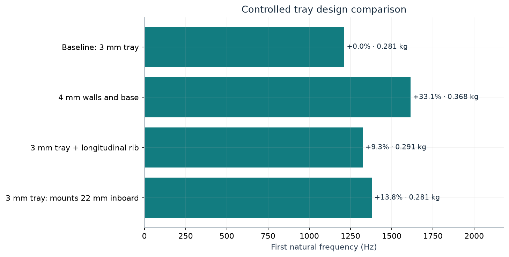

# VibeQual

**Enclosure vibration studies with Python, Gmsh and CalculiX.**

VibeQual studies how enclosure geometry and mounting affect natural frequencies and response to random base acceleration. It generates or imports CAD, meshes quadratic solids, runs CalculiX modal analysis, and integrates the response to an acceleration PSD. The report links each result to its configuration and solver output.

The reference model is a 160 × 100 × 40 mm aluminium tray with idealized mounting patches. It is a controlled structural model, not a validated model of an installed avionics assembly. Physical frequency correlation is pending; the bundled tap signal is synthetic.

## Results and design decision

The study holds the outer envelope, material, 9 mm target mesh, 50-mode basis, damping and excitation fixed. Three changes are compared with the baseline:

| Design | First frequency | Change | Mass | Mass change |
|---|---:|---:|---:|---:|
| Baseline: 3 mm walls/base | 1212.27 Hz | — | 0.28135 kg | — |
| 4 mm walls/base | 1613.96 Hz | +33.14% | 0.36810 kg | +30.83% |
| 3 × 8 mm longitudinal rib | 1324.73 Hz | +9.28% | 0.29133 kg | +3.55% |
| Mounts moved 22 mm inboard | 1379.92 Hz | +13.83% | 0.28135 kg | 0.00% |

For a fixed mounting interface, the rib is the more mass-efficient candidate among the tested stiffness changes. Its frequency gain remains **9.07% on the finer 6 mm meshes**: 1310.304 Hz versus 1201.373 Hz for the refined baseline. Moving the mounts is attractive when the installation interface can change. This comparison does not establish a global optimum, matched mode identity, or qualified hardware.



The [design study](docs/STUDIES.md) records the controls, tradeoffs, refinement and remaining uncertainty. Raw frequency/participation tables and solver decks are retained with the results.

## Modal truncation

One 50-mode eigenbasis is evaluated using smaller prefixes, keeping the mesh and probe node unchanged:

| Retained modes | Z effective mass / solver total | Probe acceleration |
|---:|---:|---:|
| 10 | 26.32% | 19.5421 g RMS |
| 20 | 62.32% | 19.3455 g RMS |
| 30 | 84.38% | 19.3727 g RMS |
| 40 | 84.52% | 19.3727 g RMS |
| 50 | 90.26% | 19.3777 g RMS |

At 50 modes the X/Y/Z fractions are 83.76% / 77.89% / 90.26% of the solver's total effective mass. The Z fraction is 89.96% when normalized by full CAD mass, including constrained material. The default response is Z-axis only; the X and Y directions need further study.

Probe acceleration changes by **0.0257% from 40 to 50 modes** on the fixed mesh. A five-mesh study converges the response to **21.71 g RMS** (0.21% change between the two finest meshes). The 9 mm screening mesh used for the reference run reads **10.7% low** because it places mode 3, which carries 13.5% of the Z mass, at 2004 Hz, just outside the 2000 Hz profile limit; refined meshes settle it at 1944 Hz, inside the band. Runs now flag significant modes near a profile edge in `band_edge_modes`. See [verification](docs/VALIDATION.md). Mode-count and mesh stability do not resolve mounting or damping uncertainty.

## Run an analysis

Ubuntu or Ubuntu under Windows WSL; Python 3.11+:

```bash
sudo apt-get update
sudo apt-get install -y python3-venv calculix-ccx libglu1-mesa
python3 -m venv .venv
source .venv/bin/activate
python -m pip install -e '.[dev,report]'
vibequal doctor
vibequal demo --out runs/demo
```

Open `runs/demo/report.html` in a browser. The report works offline and includes a rotatable, animated mode viewer. `demo` additionally creates a synthetic tap signal. A configuration-driven run omits that signal unless requested:

```bash
vibequal run examples/enclosure.json --out runs/tray
vibequal mode-study examples/enclosure.json --counts 10 20 30 40 50 --out runs/modes
vibequal design-study examples/design_variants.json --out runs/designs
vibequal run examples/ribbed_refined.json --out runs/rib-refined
vibequal converge examples/enclosure.json --sizes .012 .009 .006 .0045 .0035 --out runs/mesh-study
vibequal validate --out runs/beam
python -m pytest -q
```

Every run uses a new directory. See [installation](docs/INSTALL.md), [configuration](docs/CONFIGURATION.md) and [workflow](docs/WORKFLOW.md) for details. Native Windows solver/hardware operation is not claimed; Windows unit checks and Linux/WSL analysis are supported. Set `CCX_BIN` or pass `--ccx` when the solver is outside PATH.

## Public reference profile

An optional **MIL-STD-810H with Change 1, Method 514.8, Annex E, Figure 514.8E-1, Category 24** profile is included with document provenance. Its integral is 7.6942 g RMS, rounded to 7.7 in the figure, with one hour per axis specified. Annex E explicitly excludes minimum-integrity testing from qualification use. No DO-160 curves are included.

```bash
vibequal run examples/enclosure.json \
  --profile examples/profiles/mil_std_810h_cat24.json --out runs/category24
```

This performs a numerical single-axis screening calculation, not a physical test or compliance assessment. [PROFILE.md](docs/PROFILE.md) gives the breakpoints, source, reconstruction convention and applicability limits.

## Reference files

- [Interactive reference report](examples/reference_run/report.html): download/open locally; GitHub displays HTML source.
- [Technical report](docs/PROJECT_REPORT.pdf): methods, verification, modal study and design comparison.
- [Mode-count results](examples/studies/mode_count/mode_count.csv) and [design results](examples/studies/designs/design_comparison.csv).
- [Recorded verification](docs/VALIDATION.md): beam analytical error 0.593%, mesh and mode-count studies.
- [Theory](docs/THEORY.md): equations, units, participation, coherent summation and band-edge behavior.
- [Hardware workflow](docs/HARDWARE.md): ADALM1000 acquisition and sensor conditioning requirements.

## Implemented methods

Gmsh generates/imports a single solid and creates C3D10-compatible quadratic tetrahedra. CalculiX supplies mass-normalized mode shapes, participation and effective masses. Piecewise power-law PSD integration provides input g RMS. Miles estimates are compared with numerical SDOF integration; the full probe calculation sums complex modal transfers before integrating, retaining common-input cross terms.

A separate simply supported PCB plate model gives a first-mode deflection estimate and Steinberg margin. It is not coupled to the enclosure and does not predict service life. The tap pipeline reads uniform `time_s,voltage_v` CSV data and compares a spectral peak with a reference frequency. It does not establish mode identity or calibrated acceleration.

The 2004 Hz band-edge case illustrates a limit of Miles' equation. Its zero local PSD produces a zero Miles estimate, while the **unit-participation SDOF** integral remains about 16.2 g RMS under the illustrative profile. That number is not a standalone contribution to the full probe response; modal coefficients, base motion and coherent cross terms matter.

## Model boundaries

The tray has no lid, payload, coupled PCB, bolt contact or preload. Its 1212 Hz first mode is specific to its geometry and constraints; it is not a representative frequency for all avionics boxes. Damping is assumed. Sorted frequencies are compared without MAC-based mode tracking. A real assembly model should follow a specific physical test article and mounting arrangement.

Code and generated CAD are MIT licensed. Gmsh, CalculiX and dependencies have their own licenses; solver binaries are not bundled. See [THIRD_PARTY.md](THIRD_PARTY.md) and [references](docs/REFERENCES.md).
