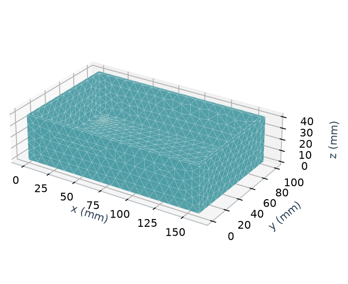
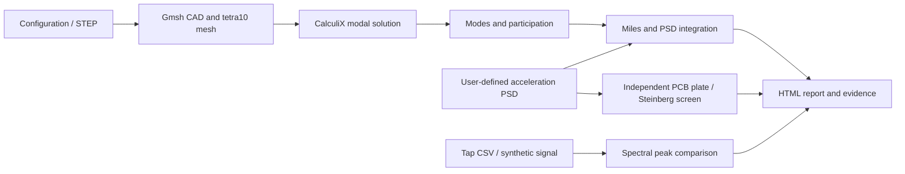

# VibeQual

### Automated vibration screening for electronics enclosures

**Python · Gmsh · CalculiX · NumPy / SciPy**

VibeQual turns an enclosure CAD model into a repeatable modal FEA run, estimates random-vibration response, and produces an offline interactive engineering report. It includes a generated aluminium tray, an independent PCB deflection screen, and a tap-test CSV analysis workflow.

This is a functional educational engineering project. The supplied results come from real CalculiX solves. The supplied tap signal is **synthetic**; no physical test or DO-160 / MIL-STD-810 qualification is claimed.



## Start with the finished example

Open **[examples/reference_run/report.html](examples/reference_run/report.html)** in a browser after downloading the repository. It works offline, including the rotatable, animated mode-shape viewer. GitHub displays HTML source rather than running the report: download it or open your local copy.

The [submission report](docs/PROJECT_REPORT.pdf) is ready to read or print. The [demo walkthrough](docs/DEMO.md) explains how to demonstrate and defend the work.

## Run it yourself

Recommended: Ubuntu 22.04 or later, including Ubuntu under Windows WSL. Python 3.11+.

```bash
sudo apt-get update
sudo apt-get install -y python3-venv calculix-ccx libglu1-mesa
python3 -m venv .venv
source .venv/bin/activate
python -m pip install -e '.[dev,report]'
vibequal doctor
vibequal demo --out runs/demo
```

Then open `runs/demo/report.html`. Every run writes into a new directory; existing results are never silently overwritten. Detailed Windows, Linux, native solver and troubleshooting instructions: [INSTALL.md](docs/INSTALL.md).

## What works

- Parametric OpenCASCADE tray with four mounting holes; STEP export and single-solid STEP import.
- Quadratic tetrahedral meshing, explicit support selection, and C3D10 CalculiX input generation.
- Real modal frequencies, mass-normalized mode shapes, participation factors and effective modal masses.
- Piecewise power-law acceleration PSDs with analytical input g RMS integration.
- Miles' equation estimates alongside numerical SDOF integration.
- Probe response from a complex, coherent modal sum under one axis of base acceleration.
- Separate simply supported PCB first-mode estimate and empirical Steinberg deflection margin.
- Tap-test CSV analysis, sample-spacing checks, spectral peak detection and frequency comparison.
- Synthetic ringdown generator with provenance metadata; optional ADALM1000 capture adapter.
- Mesh refinement, analytical cantilever verification, unit tests, end-to-end tests and GitHub Actions.
- Self-contained HTML report, CSV/JSON results, solver evidence, and a hash/version manifest.

## Commands

```bash
# Configurable full analysis; synthetic tap is opt-in for the run command
vibequal run examples/enclosure.json --out runs/custom --synthetic-tap

# Re-run the independent beam benchmark
vibequal validate --out runs/beam

# Compare three mesh sizes (metres)
vibequal converge examples/enclosure.json --sizes .012 .009 .006 --out runs/refinement

# Analyze measured data after converting it to time_s,voltage_v columns
vibequal tap measurement.csv --expected-hz 1212.265 --band 20 2000 \
  --provenance physical --out runs/tap

# Generate clearly labeled artificial data for a software-only demonstration
vibequal make-tap --frequency-hz 600 --out synthetic_tap.csv

# Test the mathematics without needing the external solver
python -m pytest -m 'not integration' -q

# Run all tests, including real CalculiX solves and STEP round-trip
python -m pytest -q
```

For a solver outside PATH, add `--ccx /absolute/path/to/ccx` to run/validate/converge or set `CCX_BIN`. See [CONFIGURATION.md](docs/CONFIGURATION.md) to change geometry, supports, material, damping, profile, probe location or PCB assumptions.

## Recorded reference results

| Quantity | Supplied demonstration |
|---|---:|
| Enclosure | Open tray, 160 × 100 × 40 mm, 3 mm walls/base |
| Material | Nominal aluminium, E = 68.9 GPa, density = 2700 kg/m³ |
| Mesh | 10,473 nodes; 5,346 C3D10 elements; 9 mm target size |
| First natural frequency | 1212.265 Hz |
| Illustrative base acceleration | 6.0367 g RMS |
| Probe acceleration, 10-mode model | 19.5421 g RMS |
| Assumed damping | 2.5% of critical; Q = 20 |
| Beam benchmark error | 0.593% against Euler-Bernoulli first bending frequency |
| Refined 6 mm enclosure first frequency | 1201.373 Hz |
| Physical experimental validation | Pending |

These are recorded results for the supplied model, not universal enclosure properties. Mesher/solver versions and platforms can shift results. The first frequency changed by about 0.91% from the 9 mm to the 6 mm mesh, while probe acceleration changed by about 9.98% relative to the 9 mm result. Response amplitude needs further refinement; see [VALIDATION.md](docs/VALIDATION.md).

## How it is organized

```text
src/vibequal/       CAD, solver, dynamics, PCB, tap analysis, CLI, report
examples/          Configurations, generated CAD, finished reference run
tests/             Independent mathematical and end-to-end verification
scripts/           Optional ADALM1000 capture, PDF report, GitHub publishing
docs/              Theory, setup, evidence, demo, hardware and project report
.github/workflows/ Automated unit and solver integration checks
```



## Engineering boundaries

The default model is a tray without a lid, payload, PCB coupling, bolt contact or preload. Supports are ideal clamps. The response is linear, uses assumed damping, and is truncated to the extracted modes. The PCB check applies the base PSD directly to a separate plate model. Its margin is not a fatigue-life prediction. A tap peak does not validate amplitudes or establish mode identity by itself.

The bundled profile is educational and user-defined. It is **not copied from or labeled as a DO-160 or MIL-STD-810 requirement**. A real standards-based assessment must identify the applicable revision, section, category, installation, axes and duration. Qualification testing is outside this project.

## Documentation

- [Theory and equations](docs/THEORY.md)
- [Verification and recorded evidence](docs/VALIDATION.md)
- [Hardware and tap-test procedure](docs/HARDWARE.md)
- [Demo and viva preparation](docs/DEMO.md)
- [Submission checklist](docs/SUBMISSION.md)
- [References](docs/REFERENCES.md)

## License and third-party software

Original project code and generated CAD: MIT, see [LICENSE](LICENSE). CalculiX and Gmsh are separately installed third-party tools with their own licenses. No third-party solver executable or proprietary standards text is bundled. See [THIRD_PARTY.md](THIRD_PARTY.md).
